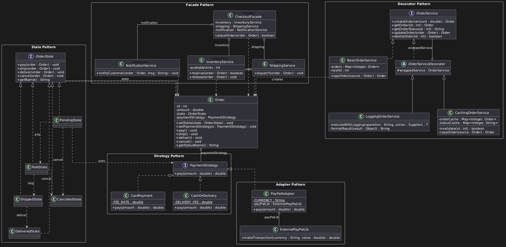
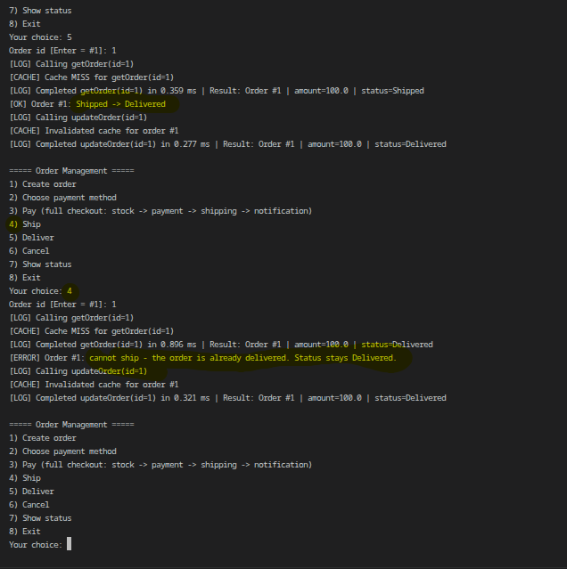

# Homework2: نظام إدارة طلبات بسيط (Design Patterns)

برنامج يعمل من سطر الأوامر، يطبّق خمسة أنماط تصميم على حالة واحدة: متجر إلكتروني بسيط (State و Strategy و Adapter و Facade و Decorator). شرح مفصّل لكل نمط في [`docs/explanation.md`](docs/explanation.md).

## 1. طريقة التشغيل

المتطلبات: JDK 17 أو أحدث (جرّبنا المشروع على Java 21).

من داخل مجلد `Homework2`:

```bash
# Linux / macOS
javac -d out $(find src -name '*.java')
java -cp out src.Main
```

```powershell
# Windows PowerShell
javac -d out (Get-ChildItem -Recurse src -Filter *.java).FullName
java -cp out src.Main
```

لتشغيل السيناريو الجاهز (ثلاث عمليات شراء ناجحة، بطاقة ثم كاش ثم PayPal، مع محاولات ممنوعة) دون كتابة المدخلات يدويًا:

```bash
java -cp out src.Main --echo < docs/demo_input.txt
```

الخيار `--echo` يطبع المدخلات المقروءة من الملف حتى يظهر الناتج كأنه جلسة كاملة.

### قائمة البرنامج

| الخيار | ما يفعله | النمط الظاهر فيه |
| --- | --- | --- |
| 1 | إنشاء طلب بمبلغ يدخله المستخدم | Decorator (خدمة الطلبات) |
| 2 | اختيار طريقة الدفع: Card أو Cash أو PayPal | Strategy و Adapter |
| 3 | دفع: مسار الشراء الكامل (مخزون ثم دفع ثم شحن ثم إشعار) | Facade و State |
| 4 | شحن | State |
| 5 | تسليم | State |
| 6 | إلغاء | State |
| 7 | عرض الحالة | Decorator (Caching) |
| 8 | خروج | |

### قرار التصميم: ماذا يفعل الخيار 3؟

اتفقنا أن الخيار **3 (دفع)** يستدعي `CheckoutFacade.placeOrder()` مرة واحدة، فيمرّ الطلب بكل الخطوات: فحص المخزون ثم الدفع بالاستراتيجية المختارة ثم الشحن ثم الإشعار. لذلك ينتهي الطلب بعد نجاح الخيار 3 في حالة **Shipped**.

الخيار **5 (تسليم)** يكمل دورة الحياة عبر State مباشرة. أما الخيار **4 (شحن)** فيمر أيضًا عبر State، وبما أن الطلب يصير Shipped بعد الخيار 3، فاستعماله بعدها يُظهر رفض State لانتقال غير مسموح (لا يمكن شحن طلب مشحون أو مسلَّم). وعندما تفشل خطوة داخل الواجهة (مثلًا لا توجد طريقة دفع) لا ينكسر البرنامج: تُطبع الرسالة ويُعاد المخزون المحجوز.

كذلك لا يتعطل البرنامج عند المدخلات الخاطئة (رقم قائمة غير صحيح، مبلغ سالب أو غير رقمي، رقم طلب غير موجود، نهاية المدخلات).

## 2. جدول الأنماط

| النمط | الكلاسات المشاركة | مكان الكود | المشكلة التي حلّها |
| --- | --- | --- | --- |
| **State** | `OrderState`, `Order`, `PendingState`, `PaidState`, `ShippedState`, `DeliveredState`, `CancelledState` | `src/state/`, `src/model/Order.java` | حالة الطلب تحدد ما يُسمح به؛ بدل `if/else` في `Order` كل حالة كلاس يعرف انتقالاته ويرفض غير المسموح |
| **Strategy** | `PaymentStrategy`, `CardPayment`, `CashOnDelivery`, `Order` | `src/payment/` | طرق دفع بحسابات مختلفة قابلة للتبديل وقت التشغيل دون `if/else` أو `switch` |
| **Adapter** | `PaymentStrategy`, `ExternalPayPalLib`, `PayPalAdapter` | `src/payment/ExternalPayPalLib.java`, `src/payment/PayPalAdapter.java` | مكتبة PayPal الخارجية واجهتها `makeTransaction(currency, value)` ولا يجوز تعديلها؛ الـ Adapter يحوّل `pay(amount)` إليها |
| **Facade** | `CheckoutFacade`, `InventoryService`, `ShippingService`, `NotificationService` | `src/facade/CheckoutFacade.java`, `src/service/` | عملية الشراء تحتاج عدة خدمات بترتيب ثابت؛ `Main` يستدعي دالة واحدة `placeOrder` |
| **Decorator** | `OrderService`, `BasicOrderService`, `OrderServiceDecorator`, `LoggingOrderService`, `CachingOrderService` | `src/decorator/`, `src/service/BasicOrderService.java` | إضافة Logging و Caching لخدمة الطلبات دون تعديل الكلاس الأصلي |

## 3. مخطط UML



> استبدلوا اسم الصورة أعلاه باسم ملف المخطط الفعلي في `docs/`.

الأنماط على المخطط:

- **State:** `OrderState` وحالاته الخمس مع `Order` كـ Context.
- **Strategy:** `PaymentStrategy` مع `CardPayment` و `CashOnDelivery` و `PayPalAdapter`.
- **Adapter:** `PayPalAdapter` يطبّق `PaymentStrategy` ويحتفظ بـ `ExternalPayPalLib`.
- **Facade:** `CheckoutFacade` مع الخدمات الثلاث.
- **Decorator:** `OrderServiceDecorator` مع `LoggingOrderService` و `CachingOrderService` فوق `BasicOrderService`.

## 4. مثال تشغيل

### نص الإخراج (سيناريو ناجح بطريقة Card، ثم محاولة انتقال ممنوعة)

الأسطر التي تبدأ بـ `>` هي اختيارات القائمة. حذفنا من النص سطور القائمة وسطور `[LOG]` و `[CACHE]` للاختصار، وهي تظهر كاملة في اللقطات وعند التشغيل.

```text
> 1
Order amount: 100
Created Order #1 | amount=100.0 | status=Pending
> 2
Order id [Enter = #1]: 
Payment methods:
  1) Card
  2) Cash on delivery
  3) PayPal
Payment method: 1
Order #1 will be paid by: Card
> 3
Order id [Enter = #1]: 
[Checkout] Placing order #1...
[Inventory] Order #1: item reserved. Units left: 9
Card payment processed. Base amount: 100.00, total with fee: 102.00
[OK] Order #1: Pending -> Paid
[OK] Order #1: Paid -> Shipped
[Shipping] Order #1: package handed to the courier.
[Notification] Order #1: your order has been paid and shipped.
[Checkout] SUCCESS: order #1 is Shipped
Purchase completed.
> 5
Order id [Enter = #1]: 
[OK] Order #1: Shipped -> Delivered
> 7
Order id [Enter = #1]: 
Status of order #1: Delivered
Order #1 | amount=100.0 | status=Delivered
> 4
Order id [Enter = #1]: 
[ERROR] Order #1: cannot ship - the order is already delivered. Status stays Delivered.
> 8
Goodbye!
```

### لقطات الشاشة

**سيناريو ناجح، دفع بالبطاقة (Card):**


**سيناريو ناجح، دفع عند الاستلام (Cash):**


**سيناريو ناجح، دفع عبر PayPal:**


**محاولة انتقال ممنوعة (State يرفضها):**



## 5. أعضاء المجموعة

**اسم المجموعة:** [املؤوا هنا]
**رقم المجموعة:** [املؤوا هنا]

| # | الاسم | الرقم الجامعي | مسؤولية في المشروع |
| --- | --- | --- | --- |
| 1 | [هبة عبد الكريم عباس] | [الرقم الجامعي] | [] |
| 2 | [هبة الله محمد سمير سنوبر] | [الرقم الجامعي] | [] |
| 3 | [خديجة بشار حسون] | [الرقم الجامعي] | [] |
| 4 | [أحمد خالد] | [الرقم الجامعي] | [] |
| 5 | [عامر برهوق] | [الرقم الجامعي] | [] |